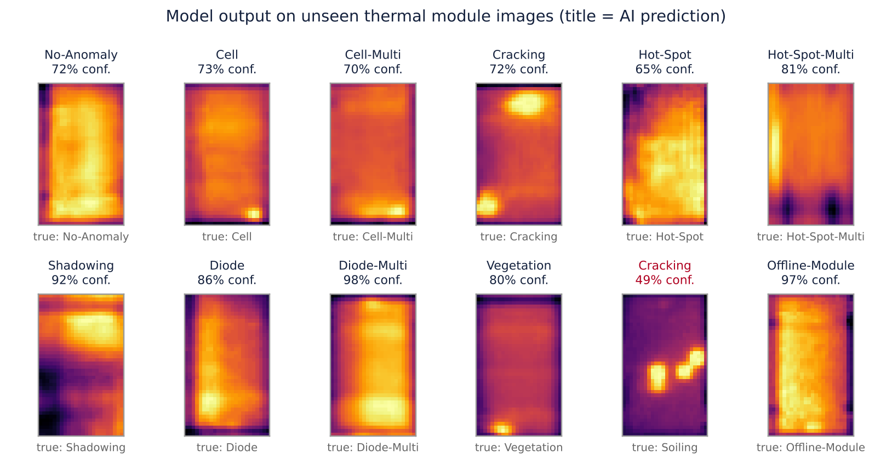
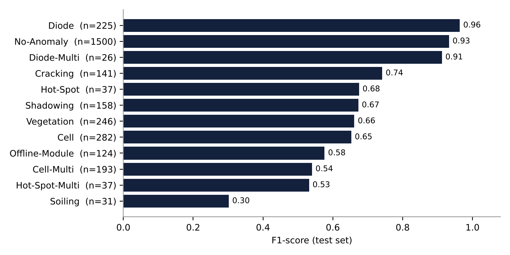

# SolarSentry

**AI that finds failing solar panels in drone thermal images and turns them into a prioritised repair list, with the energy and money each fault is costing.**

Team **The Outliers**: Omar Abidi (lead) and Ottmar Maxmilian Rosandry · School of Computing, Telkom University
Selected for the **2026–27 MAJU:ON Hackathon** by UD IMPACT (Energy·Climate track)



## Results

Tested on **3,000 thermal module images the model never saw** during training.

| Metric | PyTorch | MindSpore 2.8 (retrained) |
|---|---|---|
| Fault detection recall (faulty panels flagged) | **92.5%** | **93.6%** |
| Fault detection precision (flagged panels truly faulty) | **93.9%** | **93.1%** |
| 12-class accuracy (exact fault type) | 81.1% | 80.5% |
| Macro F1 across 12 classes | 0.68 | 0.67 |

The model is strongest on bypass-diode failures (F1 0.96 and 0.91) and weakest on soiling (0.30), which has only 31 low-resolution test examples. Per-class results are in [`results/metrics.json`](results/metrics.json).



**Simulated rooftop:** we built a 1,000-panel, 550 kWp rooftop from unseen test images, with 60 faulty panels. SolarSentry confirmed 59 faults (50 truly faulty, 9 false alarms), put 62 more on a check-next-visit list, and estimated about **8,600 kWh (Rp 12.4 million) of lost generation per year**. This is a simulation from public images, not a customer site. Full report: [`results/simulated_rooftop_report.csv`](results/simulated_rooftop_report.csv).

## Try it in one minute

```bash
pip install -r requirements.txt
python solarsentry_inspect.py sample_images --out inspection_report.csv
```

```
Inspected 28 modules: 18 confirmed faults, 2 to check on next visit.
Estimated loss from confirmed faults: 2,525 kWh/yr (Rp 3,646,351/yr). Report: inspection_report.csv
```

The CSV is the repair list, sorted by priority:

| module | status | fault | fault_score | kwh_lost_per_year | rp_lost_per_year | priority |
|---|---|---|---|---|---|---|
| module_875.jpg | confirmed fault | Diode-Multi | 1.0 | 472 | 681,754 | P1 urgent |
| module_2003.jpg | confirmed fault | Diode | 1.0 | 236 | 340,877 | P1 urgent |
| module_7505.jpg | confirmed fault | Vegetation | 0.999 | 179 | 258,240 | P2 clean/trim |

True labels for the 28 sample images are in [`results/sample_images_labels.csv`](results/sample_images_labels.csv), so you can check the predictions yourself.

## How it works

1. **Input:** one thermal image per solar module, cropped from a drone image and resized to 24 × 40 pixels.
2. **Model:** a compact CNN (three convolutional blocks, 289k parameters) classifies each module into 12 classes: No-Anomaly, Cell, Cell-Multi, Cracking, Hot-Spot, Hot-Spot-Multi, Shadowing, Diode, Diode-Multi, Vegetation, Soiling and Offline-Module. Predictions are averaged over the image and its mirror (test-time augmentation).
3. **Two confidence levels:** a fault score above 0.9 is a *confirmed fault*; 0.6 to 0.9 goes on a *check next visit* list. The thresholds were set on the validation set to keep false alarms low, since real sites are mostly healthy.
4. **Repair list:** each confirmed fault gets an estimated yearly energy and rupiah loss and a priority: P1 urgent, P2 schedule or clean, P3 monitor.

**Training:** class-weighted cross-entropy with label smoothing, AdamW with a one-cycle learning-rate schedule, flip and noise augmentation, 30 epochs, stratified 15,300 / 1,700 / 3,000 train / validation / test split. About 13 minutes on a 2-core CPU.

## MindSpore and Huawei Ascend version

[`solarsentry_ms/`](solarsentry_ms/) is the same model rewritten in **MindSpore 2.8**, for training on Huawei **ModelArts** and deployment on **Atlas** (Ascend) edge devices:

- The network is mathematically identical: PyTorch defaults that differ in MindSpore (padding, bias, BatchNorm momentum) are set explicitly, and converted weights give the same probabilities to within about 1e-7.
- [`convert_pt_to_ms.py`](solarsentry_ms/convert_pt_to_ms.py) turns the PyTorch weights into a MindSpore checkpoint and a deployable `.mindir` file.
- [`train.py`](solarsentry_ms/train.py) retrains from scratch, locally or as a ModelArts training job, on CPU, GPU or Ascend. The retrained model and its metrics are in `solarsentry_ms/out/`.
- `setup_and_run.bat` sets everything up on Windows in one click.

Details: [`solarsentry_ms/README.md`](solarsentry_ms/README.md).

## Repository structure

```
solarsentry_inspect.py     inspection tool: folder of images in, repair list CSV out
model/                     trained PyTorch weights (model.pt) and input normalisation
sample_images/             28 unseen test images covering all 12 classes
results/                   test metrics, figures, simulated rooftop report
training/                  training, figure and simulation scripts
solarsentry_ms/            MindSpore version (model, training, conversion, exported models)
docs/                      3-page prototype results summary (PDF)
```

## Retrain from scratch

Download `2020-02-14_InfraredSolarModules.zip` from [RaptorMaps/InfraredSolarModules](https://github.com/RaptorMaps/InfraredSolarModules), unzip it into `data/`, then:

```bash
python training/train.py
python training/make_figures_and_simulation.py
```

## Assumptions and limitations

- **Loss estimates** assume 550 Wp panels, 1,300 kWh/kWp per year (Java) and a tariff of Rp 1,444.70/kWh, with planning loss factors per fault type, for example 33% for one activated bypass diode and 100% for an offline module. These will be calibrated against inverter data in pilots.
- **The model classifies pre-cropped module images.** The next version will detect and locate modules directly in full drone images (YOLO) and attach GPS positions.
- **Training data comes from solar farms abroad, at low resolution.** We plan to retrain on our own Indonesian rooftop data.

## Roadmap

- [ ] Module detection in full drone frames (YOLO) with GPS-tagged repair lists
- [ ] Indonesian rooftop dataset from pilot sites
- [ ] Loss factors calibrated with inverter data
- [ ] On-site inference on an Atlas edge device

## Data credit

Millendorf, M., Obropta, E. and Vadhavkar, N. (2020). *Infrared Solar Module Dataset for Anomaly Detection.* ICLR 2020 AI for Earth Sciences workshop. Raptor Maps, MIT licence. The sample images in this repository come from that dataset.

## Contact

Omar Abidi · [GitHub](https://github.com/omar-abidi-dev) · [LinkedIn](https://www.linkedin.com/in/omar-abidi) · contact.omarabidi@gmail.com
